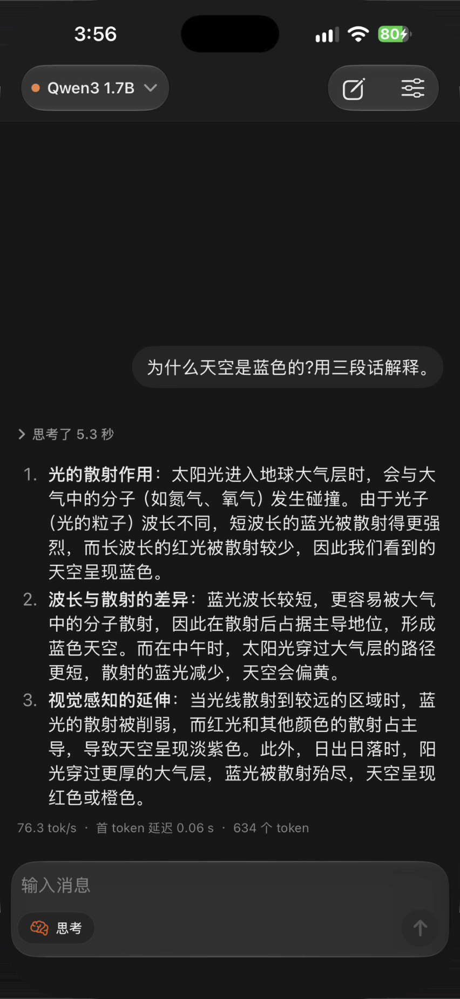
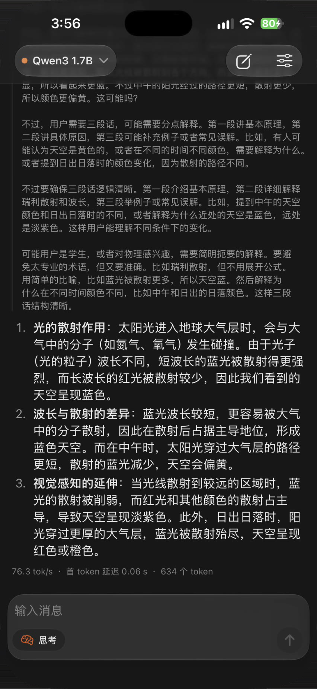
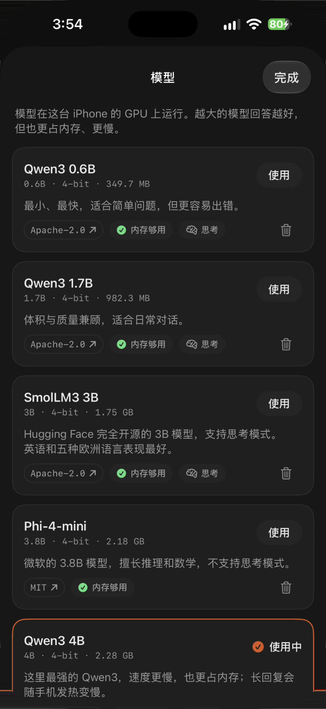
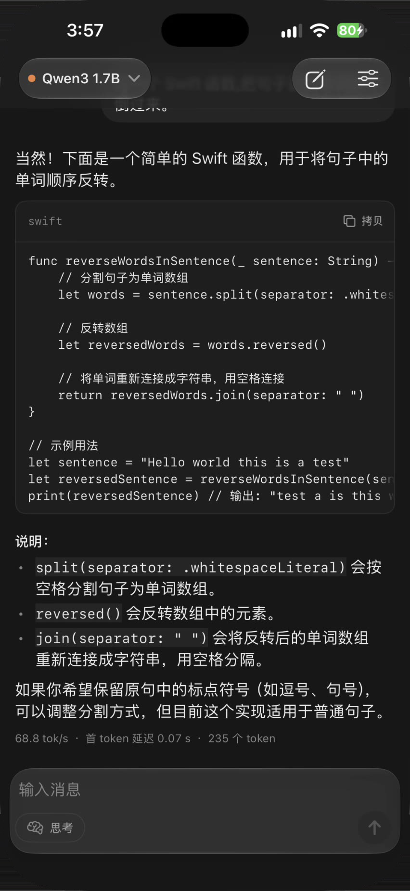

# Pocket LLM

English | [简体中文](README.zh-CN.md)

> "Pocket LLM" is a working name and will change before release.

https://github.com/user-attachments/assets/d8ab1fb9-eb3f-4aab-80b2-2472c0d2402f

_A one-minute film. The phone footage is a screen recording of this app on an iPhone 18 Pro Max; the benchmark figures in it come from [mlx-device-bench](https://github.com/Justaboringname/mlx-device-bench)._

Pocket LLM is a small open-source iPhone app. It downloads an open-weight language model from Hugging Face and runs it entirely on the phone's GPU with [MLX Swift](https://github.com/ml-explore/mlx-swift). It has no server, no account and no analytics. Your conversation stays in the app's storage on the device, and the only network traffic is the model download you ask for.

> **Status (2026-11-18): early. It has run on one iPhone, but many paths are still untested.**
> - **On a phone.** On an iPhone 18 Pro Max (12 GB, iOS 27.2.1), all five models downloaded from Hugging Face, loaded and finished a three-turn conversation. This was a Release build signed with a free Personal Team, run by the device self-test with thinking off. The measured numbers are under [Performance](#performance).
> - **Builds.** The app compiles for the iOS Simulator (Debug) and for iPhone (Release). The device build includes the privacy manifest, app icon and acknowledgements.
> - **Tests.** At the last run, the MLX-free core package had 115 unit tests and the UI had 3 XCUITest flows in the simulator; all passed. The tests added since then, for the fix described under [Known limitations](#roadmap-and-known-limitations), have not been run yet.
> - **Not yet tried on a phone:**
>   - offline use (airplane mode) and a reply that reaches the length limit;
>   - the heat warning and heat stop, stopping when the app goes to the background, and the Stop button;
>   - VoiceOver and Dynamic Type;
>   - low storage and not enough memory;
>   - an automatic download retry after a real network error;
>   - SmolLM3 3B and Phi-4-mini in Chinese.

## Screenshots

Taken on an iPhone 18 Pro Max running the Release build (Qwen3 1.7B, dark mode, phone language set to Chinese). These are frames of a screen recording made on 2026-11-19, so the speed readouts are the app's own: 76.3 tok/s for the answer with thinking on, 68.8 tok/s for the code answer.

| Chat | Thinking | Models | Code |
|---|---|---|---|
|  |  |  |  |

## Features

What the code implements today:

- **On-device chat.** Replies stream from a model running on the iPhone GPU through [mlx-swift-lm](https://github.com/ml-explore/mlx-swift-lm). They render as Markdown: headings, lists, quotes, code blocks and tables. Tapped links in replies open in the browser, `http(s)` only.
- **Five curated models.** All are Apache-2.0 or MIT licensed, and each is pinned to an exact Hugging Face commit.
  - **Downloading.** Before a download starts, the app asks for confirmation and shows the size and source. It then shows progress with a cancel button, and checks free storage first.
  - **Deleting.** Delete a model to free its space.
- **Thinking mode** for Qwen3 and SmolLM3. A toggle sits in the composer. The reasoning appears in a collapsible "Thought for N s" section and is not sent back to the model in later turns.
- **Live readout while generating.** It shows tokens per second (with a small trace), time to first token and tokens so far. Each finished reply gets a footer with its statistics, and "Length limit", "Stopped" or "Failed" markers where they apply.
- **Message actions.** Stop, regenerate the last reply, and copy, select or share a message.
- **Settings.** System prompt, temperature, maximum reply length, and a reset to the model's recommended values. The defaults come from each model card.
- **Memory-fit check per model** ("Fits" / "Tight fit" / "Too large"), based on the memory limit iOS reports for this app. Models that would not fit are not loaded. See [Memory and heat protection](#memory-and-heat-protection).
- **Safety reactions.**
  - **Heat.** A warning appears when the phone runs hot, and generation stops when it gets too hot.
  - **Background.** Generation stops when the app leaves the foreground.
  - **Memory warning.** On a memory warning the app frees caches, and unloads the model if it is idle.
- **One conversation, saved locally.** It is restored on launch. The last used model reloads automatically if it still fits.
- **First run.** The app recommends the largest model that fits comfortably and is at most 1.5 GB to download. When memory allows, that is Qwen3 1.7B.
- **Settings › Device.** Shows the app's memory limit, memory in use, whether the increased-memory entitlement is active, and the thermal state.
- **License screens.** Acknowledgements (licenses of every linked package) and Model licenses.
- **Platform.** English and Simplified Chinese UI. iPhone only, portrait only, iOS 26 or later.

## Models

| Model | Download | License | Thinking toggle | Notes |
|---|---:|---|:---:|---|
| Qwen3 0.6B | 350 MB | Apache-2.0 | yes | Smallest and fastest; makes more mistakes. |
| **Qwen3 1.7B** | 982 MB | Apache-2.0 | yes | **Recommended default.** Balanced size and quality. |
| SmolLM3 3B | 1.75 GB | Apache-2.0 | yes | The model card lists English, French, Spanish, German, Italian and Portuguese as natively supported. Its chat template always adds a short system header with today's date. |
| Phi-4-mini (3.8B) | 2.18 GB | MIT | no | Uses greedy decoding by default (temperature 0), as in the model card's examples. |
| Qwen3 4B | 2.28 GB | Apache-2.0 | yes | Largest preset. In the [LLMEval benchmark below](#library-benchmark-llmeval-example-app), run in a case without cooling, it slowed down by about 11% over 100 s of continuous generation. |

- **Source and format.** All presets are 4-bit MLX conversions from [mlx-community](https://huggingface.co/mlx-community). The sizes are what the app downloads at the pinned revision.
- **Licenses.** Repos, revisions and license details are in [docs/MODEL_LICENSES.md](docs/MODEL_LICENSES.md). Llama, Gemma 3 and LFM2 models are deliberately not included because of their license terms.
- **On a phone.** All five have run in this app on one iPhone 18 Pro Max; see [Performance](#performance). SmolLM3 3B and Phi-4-mini have not been tried in Chinese yet. Two model quirks seen there are under [Known limitations](#roadmap-and-known-limitations).

## Memory and heat protection

**Before loading, the app estimates how much memory the model needs.** The estimate (in `Packages/LLMCore/Sources/LLMCore/Device/DeviceCapability.swift`) adds three parts:

- **Weights.** The download size plus 10%.
- **Conversation memory (KV cache).** A per-token size taken from the model's `config.json`, multiplied by the prompt budget (4,096 tokens) plus the maximum reply length.
- **Runtime.** A fixed 400 MiB (about 420 MB) for the runtime and prompt processing.

**It compares that with what iOS says the app may still use.** That is `os_proc_available_memory()`, plus whatever unloading the current model would free.

| Result | Condition | What happens |
|---|---|---|
| Fits | the estimate is at most 80% of that budget | The model loads normally. |
| Tight fit | the estimate is between 80% and 100% of the budget | The model loads, with a warning that iOS may close the app. |
| Too large | the estimate is above the budget | The model is not loaded, and the app explains why. |

Estimated need with default settings, computed from that formula (not measured):

| Model | Thinking off | Thinking on |
|---|---:|---:|
| Qwen3 0.6B | 1.39 GB | 1.51 GB |
| Qwen3 1.7B | 2.09 GB | 2.20 GB |
| SmolLM3 3B | 2.72 GB | 2.79 GB |
| Phi-4-mini | 3.49 GB | — |
| Qwen3 4B | 3.68 GB | 3.83 GB |

**Other protections:**

- **Increased memory limit.** The app requests the `com.apple.developer.kernel.increased-memory-limit` entitlement, which raises the limit on supported iPhones. **Settings › Device** shows whether it is active and what limit iOS reports.
- **Long chats.** The prompt is kept under 4,096 tokens by dropping the oldest turns. The system prompt and your newest message are always kept. Each reply processes the whole trimmed conversation again; the model's working memory (the KV cache) is not reused between replies.
- **Memory warning.** The app frees MLX's GPU buffer cache. If no reply is running, it also unloads the model, which reloads on your next message.
- **Heat.** The app follows iOS's thermal state. At *serious* a "Hot" chip appears in the readout. At *critical* the running reply stops and new replies are refused until the phone cools down.
- **Leaving the app.** Generation stops as soon as the app stops being active, and the app waits until the GPU is idle before it is suspended, because iOS terminates apps that use the GPU in the background. Replies resume only when the app is active again.

## Privacy

- **No tracking.** No accounts, analytics, ads or tracking SDKs. Nothing you type is sent anywhere by the app.
- **Local storage.** The conversation and settings live in the app's storage on the device. Like other app data, they are included in your iCloud or computer backups if you use them. Model files are excluded from backups.
- **One network use.** The app goes online only to download model files from Hugging Face, after you tap Download. See [docs/PRIVACY.md](docs/PRIVACY.md) for the draft policy.

## Requirements

- **To build.**
  - macOS with Xcode 26 or later. The project is developed with Xcode 27.2 and has not been tried with older versions.
  - [XcodeGen](https://github.com/yonaskolb/XcodeGen).
  - Xcode's **Metal Toolchain** component: `xcodebuild -downloadComponent metaltoolchain`.
- **To run models.** A physical iPhone with iOS 26 or later. Which models fit depends on the memory limit iOS gives the app (see above). The iOS Simulator runs the UI with a mock engine only, because MLX needs a real Metal GPU.
- **To sign.** An Apple Account. A free Personal Team works for development, with the limits below.

## Build and run

```sh
cp Config/Local.xcconfig.example Config/Local.xcconfig
# edit Config/Local.xcconfig: set DEVELOPMENT_TEAM and BUNDLE_ID_PREFIX (this file is gitignored)

xcodegen generate              # creates LLMOnIPhone.xcodeproj (not committed)
scripts/test-core.sh           # unit tests of Packages/LLMCore on the Mac (swift test)
scripts/test-ui.sh             # UI tests (App/UITests) in the simulator, against the demo backend
scripts/build-sim.sh           # Simulator build with the mock engine
scripts/build-device.sh        # Release build for iPhone, signed with your team
xcrun devicectl device install app --device <device> .build/products/Release-iphoneos/LLMOnIPhone.app
```

- **Build output.** The scripts print the path of the built `.app` on their last line and keep logs in `.build/logs/`. `build-device.sh` redacts the team ID in its log.
- **Regenerating the project.** The scripts run `xcodegen generate` only when the project is missing. After editing `project.yml`, run it yourself.
- **Opening in Xcode.** You can also build from Xcode (`open LLMOnIPhone.xcodeproj`). The mlx-swift-lm package uses a Swift macro, so Xcode may ask you to trust it. On the command line the scripts pass `-skipMacroValidation`.
- **In the simulator.** The app uses a mock model store and a mock engine, which give canned replies and simulated statistics. Debug builds also support demo scenes for screenshots:
  - `LLM_UI_DEMO=<scene>`; `scripts/screenshots.sh` captures all of them in English and Chinese, dark and light.
  - `LLM_ACCENT=<hex>` overrides the accent color.

**Free Personal Team limits** (Apple, [compare memberships](https://developer.apple.com/support/compare-memberships/)):

- **Profiles expire after 7 days.** Rebuild and reinstall weekly.
- **App and device limits.** Up to 3 apps per device, up to 3 devices, and up to 10 App IDs, which expire after 7 days.
- **No distribution.** No TestFlight and no App Store.
- **Increased memory limit.** The free-team profile Xcode created for this project's Release build does include the increased-memory-limit entitlement (checked 2026-11-18). With it, iOS gave the app a memory limit of 6.44 GB on the 12 GB test phone.
- **Extended virtual addressing.** Not available to free teams. The app does not use it.

## Self-test harness

`App/Sources/SelfTest/SelfTestRunner.swift` is compiled only with the `SELFTEST` flag (`--selftest` in the build scripts). When launched with `LLM_SELFTEST=<catalog id>`, the app:

1. downloads the model if needed, reporting any automatic retries,
2. loads it through the same `ChatViewModel` the UI uses, including the memory-fit check,
3. runs three turns in one conversation: pick a number, double it, then explain something in about 200 words, so speed and thermal state are measured on a realistic reply,
4. records statistics, the sampling settings the engine actually used, the reply text, memory, MLX allocator numbers, thermal state and the entitlement report.

It prints one `SELFTEST {json}` line per step to stdout. It writes `Documents/selftest-result.json` before every risky step, so a run killed by iOS still leaves evidence, and again at the end. Exit codes: 0 = passed, 1 = failed, 3 = passed but cleanup failed. Self-test runs use a separate conversation file, so they never overwrite your chat.

A turn passes when it finished with answer text, or when it stopped at the length limit. A model sometimes ends its reply inside its reasoning block without closing it. The app then shows that text as the answer, and the turn is recorded with `thinkingPromoted: true`. This handling is new and has not been built or run yet (see [Known limitations](#roadmap-and-known-limitations)).

| Variable | Effect |
|---|---|
| `LLM_SELFTEST=<id>` | Required. One of `qwen3-0.6b-4bit`, `qwen3-1.7b-4bit`, `smollm3-3b-4bit`, `phi-4-mini-4bit`, `qwen3-4b-4bit`. |
| `LLM_SELFTEST_THINKING=1` | Turn thinking on for every turn. |
| `LLM_SELFTEST_GREEDY=1` | Temperature 0 for every turn (always the most likely token), so a run can be compared with a reference implementation token for token. |
| `LLM_SELFTEST_SCREENSHOTS=1` | Save `Documents/selftest-turn<N>.png` after each turn. |
| `LLM_SELFTEST_DELETE_AFTER=1` | After a passing run, unload and delete the model and report the freed bytes. |
| `LLM_SELFTEST_KEEP_ALIVE=1` | Keep the app running afterwards (default: exit). |

**In the simulator (mock engine; checks the harness and UI path, not MLX):**

```sh
scripts/selftest-sim.sh --model qwen3-1.7b-4bit [--thinking] [--greedy]   # results in .build/selftest/
```

**On a phone.** `scripts/selftest-device.sh` builds with `--selftest`, installs on the one connected iPhone, launches the harness with the console attached, copies `selftest-result.json` and the screenshots to `.build/selftest-device/<model>/`, and prints a summary. It was first run against a phone on 2026-11-18, for all five models (results under [Performance](#performance)). Keep the phone unlocked with the app in the foreground; otherwise the harness gives up after about 10 seconds.

```sh
scripts/selftest-device.sh --model qwen3-1.7b-4bit [--thinking] [--greedy] [--delete-after] [--no-build] [--dry-run]
scripts/selftest-device.sh --summary .build/selftest-device/qwen3-1.7b-4bit/selftest-result.json
```

- **Identifiers.** The script finds the phone and the bundle ID at runtime and never prints them, nor the team ID.
- **Free-team limit.** If the app is not installed yet and the phone already has 3 other development-signed apps, the script stops and lists their names. It never uninstalls anything.
- **Raw results.** `selftest-result.json` contains file paths inside the app's storage on the phone. Share the printed summary rather than the raw file.

## Project layout

```
App/
  Sources/
    LLMOnIPhoneApp.swift   app entry
    AppEnvironment.swift   composition root: real backend on a device, mocks in the simulator
    MLX/                   MLXEngine (mlx-swift-lm), HubModelDownloader (swift-huggingface)
    UI/                    SwiftUI: Chat (root), Models and Settings sheets, Markdown, Theme
    SelfTest/              on-device self-test (SELFTEST builds only)
    Demo/                  demo scenes for screenshots (DEBUG builds only)
  Resources/               asset catalog, String Catalog (en, zh-Hans), PrivacyInfo.xcprivacy,
                           Acknowledgements.json
  UITests/                 XCUITest flows (first run, send/stop, sheets) against the demo backend
  Info.plist, LLMOnIPhone.entitlements
Packages/LLMCore/          MLX-free core with unit tests: model catalog, memory-fit math,
                           safety monitor, model store, chat view model, thinking parser
Config/                    Base.xcconfig (shared), Local.xcconfig.example (copy to Local.xcconfig)
scripts/                   build, test, self-test, screenshots, strings and acknowledgements checks
docs/                      privacy policy draft, model licenses, App Store checklist (Chinese)
project.yml                XcodeGen spec (dependency versions are pinned here)
```

## Performance

### This app on a phone

Measured on 2026-11-18 by the device self-test on an iPhone 18 Pro Max (12 GB RAM, iOS 27.2.1):

- **Setup.** A Release build signed with a free Personal Team. Thinking was off, and each model used its default sampling: Phi-4-mini's default is greedy (temperature 0); the 95.5 tok/s Qwen3 1.7B figure is a greedy run.
- **Heat and memory.** The phone's thermal state stayed *nominal* (normal) throughout. With the increased-memory-limit entitlement, iOS gave the app a memory limit of 6.44 GB.
- **Which turn.** The numbers come from the third turn, an explanation of about 200 words, because that reply is long enough for a meaningful speed.
- **Ranges.** A range means the model was run more than once.

| Model | Generation speed | Reply length | Load time | Memory: after load → highest seen | Time to first token |
|---|---:|---:|---:|---:|---:|
| Qwen3 0.6B | 180–186 tok/s | 383–385 tokens | 0.3 s | 0.44 → 0.60 GB | 0.04 s |
| Qwen3 1.7B | 89 tok/s (sampled), 95.5 tok/s (greedy) | 126–240 tokens | 0.3–0.4 s | 1.07 → 1.29 GB | 0.07–0.08 s |
| SmolLM3 3B | 53.5 tok/s | 398 tokens | 0.6 s | 1.85 → 2.07 GB | 0.18 s |
| Phi-4-mini | 45.2 tok/s (one run) | 360 tokens | 0.7 s | 2.28 → 2.51 GB | 0.14 s |
| Qwen3 4B | 41.2 tok/s | 271 tokens | 0.7 s | 2.37 → 2.59 GB | 0.16 s |

- **Memory.** This is the app's footprint, the figure iOS compares with the memory limit. It was read only after loading and after each turn, so a short peak in between would not show.
  - Even the largest model stayed well under the 6.44 GB limit, and below the [estimates](#memory-and-heat-protection) the app uses for its fit check.
  - Those estimates assume a full 4,096-token prompt plus the longest reply. These were short conversations, so the estimates are not yet confirmed for long chats.
- **Time to first token.** This is the time from sending to the first text, including reading the prompt.
- **Downloads over Wi-Fi.** Qwen3 1.7B (982 MB) took 11.3 s and Qwen3 0.6B (350 MB) took 4.3 s.
  - The very first download attempt failed after 5 s because the network connection was lost (`NSURLError -1005`). Running it again at once worked.
  - Automatic retries were added after that. A fresh download through the new code needed none, so a retry after a real network error has not been seen yet.
- **Deleting.** Deleting a model after a run (`--delete-after`) freed 0.35 GB, and downloading it again worked.
- **Thinking on.** Qwen3 1.7B got all three turns right (25, then 50, then a coherent essay) at 87–88 tok/s, and closed its reasoning block each time. SmolLM3 3B did not close its block in the third turn; see [Known limitations](#roadmap-and-known-limitations).
- **Greedy decoding.** Phi-4-mini's 360-token reply ended normally, with no repetition loop. This is one sample.
- **Display.** Bold Markdown rendered correctly on the phone, and the chat screen looked right in the self-test's screenshots.
- **Length limit.** Every reply ended on its own; none reached the length limit. So the length-limit workaround (see [Known limitations](#roadmap-and-known-limitations)) has still not run on a phone.

### Library benchmark (LLMEval example app)

**These are not measurements of this app.** They were taken on 2026-11-18 on an iPhone 18 Pro Max (12 GB RAM, iOS 27.2) with the **LLMEval example app from [ml-explore/mlx-swift-examples](https://github.com/ml-explore/mlx-swift-examples)**. That app was built in Release with the same library versions this app pins (mlx-swift 0.31.4, mlx-swift-lm 3.31.3), using 4-bit weights and temperature 0.

| | Qwen3-1.7B-4bit | Qwen3-4B-4bit |
|---|---:|---:|
| Generation speed | 99.7 tok/s | 44.6 tok/s |
| 10k-token prompt | 2,008 tok/s (5.0 s to first token) | 801 tok/s (12.6 s to first token) |
| Peak memory | 2.65 GB | 4.27 GB |
| 100 s continuous generation | no slowdown, no thermal warning | in a case, no cooler: the end was 11.4% slower than the start, and `thermalState` reached 2 (*serious*) |
| Same, with an external cooler and no case | — | steady 44.7 tok/s, `thermalState` 0, so the slowdown is thermal |
| Whole-device power | about 11.9 W | — |

Other results from the same session:

- **Memory limit.** With the increased-memory-limit entitlement, `os_proc_available_memory()` reported 6.43 GB at launch on this 12 GB phone.
- **Prompt length.** This app trims prompts to 4,096 tokens by default, so its prompts are shorter than the 10k-token test above.
- **Thermal warning.** *Serious* is the level at which this app shows its "Hot" warning.
- **Not comparable with this app's table.** LLMEval's peak memory is measured differently from the footprint in this app's table above, and its prompts were much longer. Do not set the two side by side.

## Roadmap and known limitations

- **More testing on a phone.** The self-test has run for all five models on one phone (see [Performance](#performance)). Still to do:
  - the paths listed under *Not yet tried on a phone* at the top;
  - thinking on with Qwen3 0.6B and Qwen3 4B;
  - long conversations near the 4,096-token prompt budget, which is where the memory estimates matter;
  - screenshots for the App Store (this page now has real ones).
- **SmolLM3 3B can leave its reasoning block open (seen once).** With thinking on, it handled the first two turns of the self-test normally. In the third turn it wrote its reasoning and then the whole essay inside the reasoning block, and ended the reply without closing the block.
  - **What the app showed.** 1,943 characters of "reasoning" and an empty answer, so the self-test failed that turn.
  - **The fix in the code.** When a reply ends like that and has no other answer, the app now shows that text as the answer, with a "Reasoning shown as answer" note in the footer.
  - **Not tested.** This fix has **not been built or tested yet**.
  - **Related display changes.** A reply that hits the length limit while still reasoning keeps it as reasoning, and the footer says "Length limit while thinking". Any finished reply without an answer now shows its reasoning expanded.
- **Qwen3 1.7B without thinking often ignores a number range.** Asked to "pick a whole number between 11 and 49", it answered out of range (for example 57 or 67) in roughly half the runs.
  - **Also with greedy decoding.** Always taking the most likely token, it answered 67 and then doubled it correctly to 134.
  - **Why it looks like the model.** The other four models answer correctly through the same code, and a review of the sampling code found nothing wrong. So this looks like a limitation of this small 4-bit model without thinking. It has **not** been cross-checked against a reference implementation on a Mac.
  - **With thinking on,** it answered all three turns correctly.
- **Length-limited replies (library bug, worked around).** mlx-swift-lm 3.31.3 reports a reply that reaches the token limit as *cancelled* rather than *length*: a source read of `MLXLMCommon/Evaluate.swift` shows the generation loop iterating a copy of the token iterator, so the library's token counter stays at 0. `MLXEngine` therefore decides itself: if nobody asked to stop and the reply has `maxTokens` tokens, it reports the length limit, and the app shows "Length limit" rather than "Stopped". The workaround is unit-tested. In the phone runs every reply ended on its own, so it has not run on a phone yet.
- **Stop waits for the prompt.** Prompt processing (prefill) cannot be interrupted. Stop, and leaving the app, wait until the prompt has been read; only the generation that follows stops at once. Cooperative cancellation during prefill arrived in mlx-swift-lm 3.32.3.
- **No KV-cache reuse between turns.** Every reply re-reads the whole trimmed conversation.
- **Downloads.**
  - They run only while the app is open; the app does not use a background download session.
  - A dropped connection, a timeout or a temporary server error is retried automatically, up to 3 times within about 7 seconds. Without an internet connection the download stops at once and says so. If it still fails, the model card shows the reason and a Retry button.
  - The automatic retry was added after the first download on a phone failed with a lost connection. It has not yet been seen retrying after a real network error.
  - Resume works per file: completed files are kept, but an interrupted file starts again from zero.
- **One conversation.** There is no history list and no export beyond copy and share.
- **No content filter.** Replies can be inaccurate or inappropriate, and the Settings screen says so.
- **Hidden links.** The "Report a problematic response" link and the in-app privacy-policy link stay hidden until `SUPPORT_URL` and `PRIVACY_POLICY_URL` are set in `Config/Base.xcconfig`.
- **Library upgrade (after v1).**
  - v1 stays on mlx-swift 0.31.4 and mlx-swift-lm 3.31.3.
  - mlx-swift-lm 3.33.0 and mlx-swift 0.33.0 exist but are source-breaking: `sanitize` now throws, there are new enum cases, the `progressHandler:` load overloads are deprecated, and `ChatSession` isolation changed.
  - Upgrading would bring leak and cancellation fixes. It would also make Qwen 3.5 and Gemma 4 E2B (both Apache-2.0) possible presets.
- **Platform.** iPhone only, portrait only.

## Acknowledgements

- [MLX](https://github.com/ml-explore/mlx), [mlx-swift](https://github.com/ml-explore/mlx-swift) and [mlx-swift-lm](https://github.com/ml-explore/mlx-swift-lm) by Apple's ml-explore team, which also made the LLMEval example used for the benchmark above.
- [swift-transformers](https://github.com/huggingface/swift-transformers), [swift-huggingface](https://github.com/huggingface/swift-huggingface) and [swift-jinja](https://github.com/huggingface/swift-jinja) by Hugging Face.
- The [mlx-community](https://huggingface.co/mlx-community) conversions.
- The model authors: the Qwen team at Alibaba Cloud (Qwen3), Hugging Face (SmolLM3) and Microsoft (Phi-4-mini).
- Every package linked into the app, with its license text, is listed in the app under **Settings › About › Acknowledgements**. That list is generated by `scripts/gen-acknowledgements.py`.

## License

[MIT](LICENSE).

Model weights are not part of this repository. Each model keeps its own license (see [docs/MODEL_LICENSES.md](docs/MODEL_LICENSES.md)).
