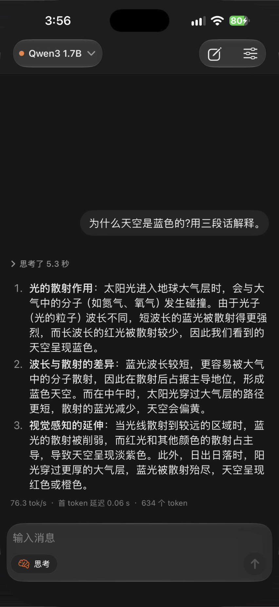
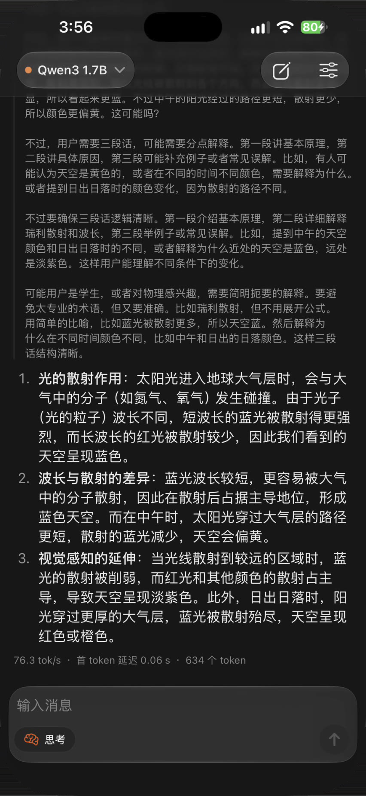
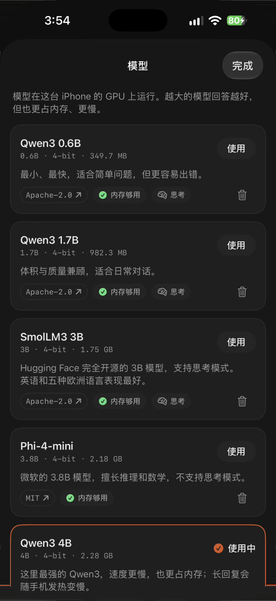
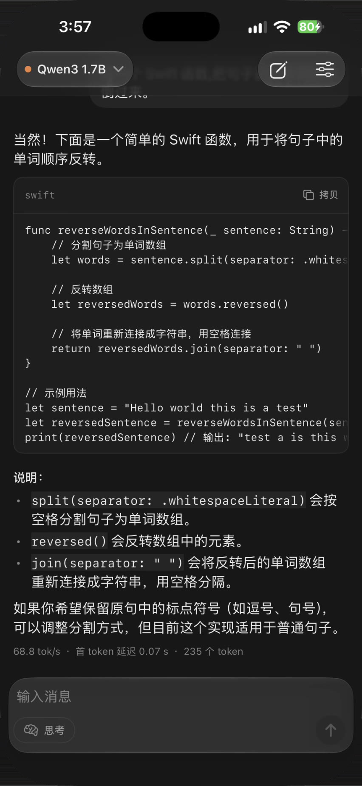

# Pocket LLM

[English](README.md) | 简体中文

> "Pocket LLM" 是暂定名,正式发布前会改。

https://github.com/user-attachments/assets/d8ab1fb9-eb3f-4aab-80b2-2472c0d2402f

_一分钟的宣传片。手机画面是本 app 在 iPhone 18 Pro Max 上的录屏;片中的基准数字来自 [mlx-device-bench](https://github.com/Justaboringname/mlx-device-bench)。_

Pocket LLM 是一个开源的 iPhone 小 app:从 Hugging Face 下载开放权重的语言模型,用 [MLX Swift](https://github.com/ml-explore/mlx-swift) 完全在手机 GPU 上运行。没有服务器、没有账号、没有统计分析。对话只存在本机的 app 存储里,唯一的联网是你主动发起的模型下载。

> **当前状态(2026-11-18):早期版本。已经在一台 iPhone 上跑通,但还有很多情况没测过。**
> - **真机。** 测试机是一台 iPhone 18 Pro Max(12 GB 内存,iOS 27.2.1),装的是用免费 Personal Team 签名的 Release 包。真机自测(不开思考)里,五个模型都从 Hugging Face 下载成功、加载成功,并完成了三轮对话。实测数字见[性能](#性能)。
> - **编译。** 模拟器 Debug 版、真机 Release 版都能编译通过;真机包已经包含隐私清单、图标和致谢页。
> - **测试。** 最后一次跑的时候,不依赖 MLX 的核心包有 115 个单元测试,界面在模拟器里有 3 个 XCUITest 流程测试,全部通过。之后为[已知限制](#路线图与已知限制)里那个修复新加的测试,还没跑过。
> - **还没在手机上试过的:**
>   - 离线使用(飞行模式),以及回复达到长度上限;
>   - 发热提示和过热停止、切到后台时停止生成、"停止"按钮;
>   - VoiceOver(旁白)和动态字体(系统设置里的大字号);
>   - 存储空间不足、内存不够时的提示;
>   - 真实网络出错后的自动重试;
>   - 用中文和 SmolLM3 3B、Phi-4-mini 对话。

## 截图

在 iPhone 18 Pro Max 上用 Release 版截的(Qwen3 1.7B,深色模式,手机语言是中文)。这几张是 2026-11-19 一段录屏里的帧,所以画面里的速度是 app 自己显示的读数:开思考的回答 76.3 tok/s,写代码的回答 68.8 tok/s。

| 对话 | 思考 | 模型 | 代码 |
|---|---|---|---|
|  |  |  |  |

## 功能

以下是代码里已经实现的功能:

- **本机对话。** 模型通过 [mlx-swift-lm](https://github.com/ml-explore/mlx-swift-lm) 跑在 iPhone GPU 上,回复逐字流式显示,按 Markdown 渲染(标题、列表、引用、代码块、表格)。回复里的链接点了才会在浏览器打开,而且只放行 http(s)。
- **精选的五个模型。** 都是 Apache-2.0 或 MIT 许可,每个都固定到 Hugging Face 上的某个具体 commit。
  - **下载。** 下载前先确认,写明大小和来源,还会先检查剩余空间。下载过程显示进度,可以随时取消。
  - **删除。** 可以删除模型释放空间。
- **思考模式**(Qwen3 和 SmolLM3)。开关在输入框旁边。推理过程放在可折叠的"思考了 N 秒"区域里,后续轮次不会再发回给模型。
- **实时读数。** 生成时显示每秒 token 数(带小走势图)、首个 token 用时、已生成 token 数。每条回复结束后,页脚附上统计,必要时标出"已达长度上限""已停止"或"失败"。
- **消息操作。** 可以停止生成、重新生成最后一条回复,也可以拷贝、选择文本、共享消息。
- **设置。** 可以改系统提示词、温度、单次回复上限,也能一键恢复模型推荐值(默认值取自各模型的 model card)。
- **按模型检查内存。** 根据 iOS 报告的本 app 可用内存,给每个模型标出"内存够用 / 内存紧张 / 内存不足"。装不下的模型不会加载。详见[内存与发热保护](#内存与发热保护)。
- **安全机制。**
  - **发热。** 手机发热时给出提示,过热时停止生成。
  - **切到后台。** app 一离开前台就停止生成。
  - **内存警告。** 收到内存警告时释放缓存;模型空闲的话,顺便把它卸载。
- **单个对话,本机保存。** 启动时自动恢复,上次用的模型如果还装得下也会自动加载。
- **首次启动推荐。** 推荐"内存充裕、且下载不超过 1.5 GB"的模型里最大的一个,内存允许时就是 Qwen3 1.7B。
- **设置 › 设备。** 显示本 app 的内存上限、已用内存、"提高内存上限"权限是否生效,以及温度状态。
- **许可证页面。** 有"致谢"(列出所有链接进来的开源包及许可证原文)和"模型许可证"两个页面。
- **平台。** 界面支持英文和简体中文。只支持 iPhone,只支持竖屏,需要 iOS 26 或更高版本。

## 模型

| 模型 | 下载大小 | 许可证 | 思考开关 | 说明 |
|---|---:|---|:---:|---|
| Qwen3 0.6B | 350 MB | Apache-2.0 | 有 | 最小最快,错误也更多。 |
| **Qwen3 1.7B** | 982 MB | Apache-2.0 | 有 | **默认推荐。** 大小和质量比较均衡。 |
| SmolLM3 3B | 1.75 GB | Apache-2.0 | 有 | model card 写明原生支持英、法、西、德、意、葡六种语言,中文不在其中。它的对话模板总会加一段带当天日期的系统信息。 |
| Phi-4-mini(3.8B) | 2.18 GB | MIT | 无 | 默认贪心解码(温度 0),和 model card 里的示例一致。 |
| Qwen3 4B | 2.28 GB | Apache-2.0 | 有 | 最大的一个。[下面](#性能)用 LLMEval 做的测试里,带壳、不加散热连续生成 100 秒,末尾比开头慢了约 11%。 |

- **来源。** 全部是 [mlx-community](https://huggingface.co/mlx-community) 的 4-bit MLX 转换版,大小是 app 在固定版本下实际要下载的量。
- **许可证。** 仓库、版本号和许可证细节见 [docs/MODEL_LICENSES.md](docs/MODEL_LICENSES.md)。Llama、Gemma 3、LFM2 因为许可条款被刻意排除在外。
- **上过手机了。** 五个模型都已经在一台 iPhone 18 Pro Max 上、在本 app 里跑过,见[性能](#性能)。SmolLM3 3B 和 Phi-4-mini 还没试过用中文对话。真机上发现的两个模型自身的毛病,写在[已知限制](#路线图与已知限制)里。

## 内存与发热保护

**加载之前,app 先估算这个模型要多少内存。** 公式在 `Packages/LLMCore/Sources/LLMCore/Device/DeviceCapability.swift`,由三部分相加:

- **权重。** 下载大小再加 10%。
- **对话缓存(KV cache)。** 按模型 `config.json` 算出每个 token 占多少,乘以"提示词预算 4,096 个 token + 回复上限"。
- **运行时。** 固定再留 400 MiB(约 420 MB),给运行时和提示词处理用。

**再拿它和 iOS 允许本 app 还能用的内存比较。** 也就是 `os_proc_available_memory()`,加上卸载当前模型能腾出来的那部分。

| 结果 | 条件 | 会发生什么 |
|---|---|---|
| 内存够用 | 估算不超过可用量的 80% | 正常加载。 |
| 内存紧张 | 估算在可用量的 80% 到 100% 之间 | 可以加载,但会提示 iOS 可能会关掉 app。 |
| 内存不足 | 估算超过可用量 | 不加载,并说明原因。 |

按上面的公式,默认设置下的估算值(算出来的,不是实测):

| 模型 | 不开思考 | 开思考 |
|---|---:|---:|
| Qwen3 0.6B | 1.39 GB | 1.51 GB |
| Qwen3 1.7B | 2.09 GB | 2.20 GB |
| SmolLM3 3B | 2.72 GB | 2.79 GB |
| Phi-4-mini | 3.49 GB | — |
| Qwen3 4B | 3.68 GB | 3.83 GB |

**其他保护:**

- **提高内存上限。** app 申请了 `com.apple.developer.kernel.increased-memory-limit` 权限,在支持的 iPhone 上能拿到更高的上限。**设置 › 设备** 里能看到它是否生效、iOS 实际给了多少。
- **长对话。** 提示词超过 4,096 个 token 时,从最早的轮次开始丢,系统提示词和你最新的一条消息永远保留。每次回复都会把裁剪后的整段对话重新读一遍,轮次之间不复用 KV cache(模型的"工作记忆")。
- **内存警告。** 释放 MLX 的 GPU 缓存;如果当时没在生成,就把模型卸载,下次发消息时再自动加载。
- **发热。** 跟随 iOS 的温度状态。到 *serious*(偏热)时,读数条上出现"发热"提示;到 *critical*(过热)时,正在生成的回复会停下,降温之前不接受新的请求。
- **离开 app。** app 一不在前台就停止生成,并等 GPU 空闲后才让系统挂起,因为 iOS 会终止在后台使用 GPU 的 app。回到前台后才能继续生成。

## 隐私

- **不追踪。** 没有账号、统计分析、广告或追踪 SDK。你输入的内容,app 不会发到任何地方。
- **本机存储。** 对话和设置存在本机的 app 存储里;如果你用 iCloud 或电脑备份,它们会和其他 app 数据一样进入备份。模型文件不进备份。
- **唯一的联网。** 只有你点了下载,app 才会从 Hugging Face 下载模型文件。隐私政策草稿见 [docs/PRIVACY.zh-CN.md](docs/PRIVACY.zh-CN.md)。

## 环境要求

- **编译。**
  - macOS + Xcode 26 或更高版本(项目用 Xcode 27.2 开发,更早的版本没试过)。
  - [XcodeGen](https://github.com/yonaskolb/XcodeGen)。
  - Xcode 的 **Metal Toolchain** 组件:`xcodebuild -downloadComponent metaltoolchain`。
- **运行模型。** 需要 iOS 26 或更高版本的真机。哪些模型装得下,取决于 iOS 给本 app 的内存上限(见上文)。iOS 模拟器只能用模拟引擎看界面,因为 MLX 需要真正的 Metal GPU。
- **签名。** 需要一个 Apple 账号。开发阶段用免费的 Personal Team 就行,限制见下文。

## 编译与运行

```sh
cp Config/Local.xcconfig.example Config/Local.xcconfig
# 编辑 Config/Local.xcconfig:填 DEVELOPMENT_TEAM 和 BUNDLE_ID_PREFIX(这个文件不进 git)

xcodegen generate              # 生成 LLMOnIPhone.xcodeproj(工程文件不提交)
scripts/test-core.sh           # 在 Mac 上跑 Packages/LLMCore 的单元测试(swift test)
scripts/test-ui.sh             # 在模拟器里跑 UI 测试(App/UITests),用演示后端
scripts/build-sim.sh           # 模拟器版本,用模拟引擎
scripts/build-device.sh        # 真机 Release 版本,用你的 team 签名
xcrun devicectl device install app --device <设备> .build/products/Release-iphoneos/LLMOnIPhone.app
```

- **编译产物。** 脚本最后一行会打印编好的 `.app` 路径,日志放在 `.build/logs/`。`build-device.sh` 写日志时会把 team ID 打码。
- **重新生成工程。** 脚本只在工程文件不存在时才跑 `xcodegen generate`,改了 `project.yml` 要自己手动再跑一次。
- **用 Xcode 打开。** 也可以 `open LLMOnIPhone.xcodeproj` 用 Xcode 编。mlx-swift-lm 用到了 Swift 宏,Xcode 可能会让你确认信任它;命令行脚本则带了 `-skipMacroValidation`。
- **模拟器里。** 用的是模拟的模型仓库和模拟引擎,回复是预先写好的,统计数字也是模拟的。Debug 版还支持用于截图的演示场景:
  - `LLM_UI_DEMO=<场景>`;`scripts/screenshots.sh` 会把所有场景按中英文、深浅色各截一遍。
  - `LLM_ACCENT=<十六进制颜色>` 可以临时换强调色。

**免费 Personal Team 的限制**(来自 Apple 的[会员类型对比](https://developer.apple.com/support/compare-memberships/)):

- **描述文件 7 天过期。** 每周要重新编译安装。
- **app 与设备数量。** 每台设备最多装 3 个这样的 app,最多登记 3 台设备,最多 10 个 App ID(同样 7 天过期)。
- **不能分发。** 不能用 TestFlight,也不能上 App Store。
- **提高内存上限。** 本项目 Release 包里那份由 Xcode 为免费 team 生成的描述文件,确实包含"提高内存上限"权限(2026-11-18 核对)。带着这个权限,iOS 在这台 12 GB 的测试机上给本 app 的内存上限是 6.44 GB。
- **扩展虚拟寻址。** 免费 team 拿不到;本 app 也没用它。

## 自测工具

`App/Sources/SelfTest/SelfTestRunner.swift` 只在带 `SELFTEST` 编译条件时才会编进去(构建脚本加 `--selftest`)。用 `LLM_SELFTEST=<模型 id>` 启动后,app 会:

1. 需要的话先下载模型,自动重试过的话也会记下来;
2. 通过界面用的同一个 `ChatViewModel` 加载模型,内存检查也照常走一遍;
3. 在同一个对话里跑三轮:先选一个数,再让它把这个数乘以二,最后让它用 200 字左右讲解一个问题,这样速度和温度是在真实长度的回复上测出来的;
4. 记录统计数字、引擎实际用的采样参数、回复全文、内存、MLX 分配器数据、温度状态和权限情况。

每一步都往标准输出打印一行 `SELFTEST {json}`。每个有风险的步骤之前都会先写一次 `Documents/selftest-result.json`,这样就算被 iOS 杀掉也有记录可查;结束时再写一次最终结果。退出码:0 通过,1 失败,3 通过但清理失败。自测用单独的对话文件,不会覆盖你自己的聊天记录。

一轮算通过,条件是回复正常结束并且有回答文字,或者停在了长度上限。模型有时会在"思考块"里把话说完,却始终不写结束标记 `</think>`。思考块就是模型先写推理过程的那一段,app 会把它折叠起来。遇到这种情况,app 现在会把这段文字当作回答显示,这一轮在结果里记为 `thinkingPromoted: true`。这个处理是新加的,还没编译、没跑过(见[已知限制](#路线图与已知限制))。

| 环境变量 | 作用 |
|---|---|
| `LLM_SELFTEST=<id>` | 必填。可选 `qwen3-0.6b-4bit`、`qwen3-1.7b-4bit`、`smollm3-3b-4bit`、`phi-4-mini-4bit`、`qwen3-4b-4bit`。 |
| `LLM_SELFTEST_THINKING=1` | 每一轮都开思考。 |
| `LLM_SELFTEST_GREEDY=1` | 每一轮温度都设为 0(每步都取概率最高的 token),方便和参考实现逐 token 对比。 |
| `LLM_SELFTEST_SCREENSHOTS=1` | 每轮结束后存一张 `Documents/selftest-turn<N>.png`。 |
| `LLM_SELFTEST_DELETE_AFTER=1` | 通过后卸载并删除模型,报告释放了多少空间。 |
| `LLM_SELFTEST_KEEP_ALIVE=1` | 跑完不退出(默认会退出)。 |

**模拟器里跑(模拟引擎,只检验自测流程和界面,不检验 MLX):**

```sh
scripts/selftest-sim.sh --model qwen3-1.7b-4bit [--thinking] [--greedy]   # 结果在 .build/selftest/
```

**真机上跑。** 用 `scripts/selftest-device.sh`:它会带 `--selftest` 编译,装到唯一连着的那台 iPhone 上,挂着控制台启动自测,把 `selftest-result.json` 和截图拷到 `.build/selftest-device/<模型>/`,最后打印摘要。2026-11-18 第一次对真机实际跑了这个脚本,五个模型都跑过(结果见[性能](#性能))。手机要保持解锁、app 在前台,否则自测等 10 秒左右就会放弃。

```sh
scripts/selftest-device.sh --model qwen3-1.7b-4bit [--thinking] [--greedy] [--delete-after] [--no-build] [--dry-run]
scripts/selftest-device.sh --summary .build/selftest-device/qwen3-1.7b-4bit/selftest-result.json
```

- **标识。** 脚本在运行时自己找设备、读 Bundle ID,不会打印它们,也不会打印 Team ID。
- **免费账号上限。** 如果 app 还没装、手机上已经有 3 个其他开发签名的 app,脚本会停下并列出它们的名字,不会替你卸载任何东西。
- **原始结果文件。** `selftest-result.json` 里有 app 在手机上的存储路径,要分享的话请贴脚本打印的摘要,别贴原文件。

## 目录结构

```
App/
  Sources/
    LLMOnIPhoneApp.swift   app 入口
    AppEnvironment.swift   组装入口:真机用真实后端,模拟器用模拟后端
    MLX/                   MLXEngine(mlx-swift-lm)、HubModelDownloader(swift-huggingface)
    UI/                    SwiftUI:对话(主界面)、模型和设置两个弹出页、Markdown、主题
    SelfTest/              真机自测(只在 SELFTEST 构建里)
    Demo/                  截图用演示场景(只在 DEBUG 构建里)
  Resources/               资源目录、字符串目录(en、zh-Hans)、PrivacyInfo.xcprivacy、
                           Acknowledgements.json
  UITests/                 XCUITest 界面流程测试(首次启动、发送/停止、弹出页),用演示后端
  Info.plist、LLMOnIPhone.entitlements
Packages/LLMCore/          不依赖 MLX 的核心和单元测试:模型目录、内存估算、安全监控、
                           模型存储、对话 ViewModel、思考内容解析
Config/                    Base.xcconfig(共用)、Local.xcconfig.example(复制成 Local.xcconfig)
scripts/                   编译、测试、自测、截图、字符串和致谢检查
docs/                      隐私政策草稿、模型许可证、App Store 上架清单
project.yml                XcodeGen 配置(依赖版本固定在这里)
```

## 性能

### 本 app 的真机实测

2026-11-18 用真机自测测得,设备是 iPhone 18 Pro Max(12 GB 内存,iOS 27.2.1)。

- **条件。** 用免费 Personal Team 签名的 Release 包,不开思考,每个模型用自己的默认采样参数。采样参数决定模型怎么从候选词里挑下一个词。Phi-4-mini 的默认就是贪心解码(温度 0,每一步都取概率最高的 token,结果可复现);Qwen3 1.7B 的 95.5 tok/s 那次也是贪心解码。
- **温度与内存。** 全程温度状态都是 *nominal*(正常)。带着"提高内存上限"权限,iOS 给本 app 的内存上限是 6.44 GB。
- **取哪一轮。** 数字取自第三轮:一段 200 字左右的讲解,够长,速度才有参考意义。
- **范围。** 写成范围的,是同一个模型跑了不止一次。

**几个说法:**

- **token。** 模型处理文字的最小单位,一个英文单词通常是一到两个 token。
- **tok/s。** 每秒生成多少个 token。
- **首 token 延迟。** 从发出消息到出现第一个字的时间,其中包括模型读完整段提示词的时间。
- **内存占用。** iOS 统计的本 app 实际占用(footprint),也就是 iOS 拿去和内存上限比、超了就杀掉 app 的那个数。

| 模型 | 生成速度 | 回复长度 | 加载耗时 | 内存占用:加载后 → 测到的最高值 | 首 token 延迟 |
|---|---:|---:|---:|---:|---:|
| Qwen3 0.6B | 180–186 tok/s | 383–385 token | 0.3 秒 | 0.44 → 0.60 GB | 0.04 秒 |
| Qwen3 1.7B | 89 tok/s(随机采样),95.5 tok/s(贪心) | 126–240 token | 0.3–0.4 秒 | 1.07 → 1.29 GB | 0.07–0.08 秒 |
| SmolLM3 3B | 53.5 tok/s | 398 token | 0.6 秒 | 1.85 → 2.07 GB | 0.18 秒 |
| Phi-4-mini | 45.2 tok/s(只跑了一次) | 360 token | 0.7 秒 | 2.28 → 2.51 GB | 0.14 秒 |
| Qwen3 4B | 41.2 tok/s | 271 token | 0.7 秒 | 2.37 → 2.59 GB | 0.16 秒 |

- **内存。** 只在加载后和每轮结束时各读一次,两次之间的短暂高峰看不到。
  - 最大的模型也远低于 6.44 GB 的上限,也低于 app 做内存检查时用的[估算值](#内存与发热保护)。
  - 不过估算按"提示词塞满 4,096 个 token + 最长回复"算,而这几次都是短对话,长对话下估算准不准还没验证。
- **Wi-Fi 下载。** Qwen3 1.7B(982 MB)用了 11.3 秒,Qwen3 0.6B(350 MB)用了 4.3 秒。
  - 当天第一次下载 5 秒后失败,原因是网络连接中断(`NSURLError -1005`);马上重跑就成功了。
  - 之后才加上自动重试。用新代码重新下载一次,没用到重试,所以"真遇到网络错误时自动重试"还没亲眼见过。
- **删除。** 自测跑完删除模型(`--delete-after`)释放了 0.35 GB,之后重新下载也正常。
- **开思考。** Qwen3 1.7B 三轮全对(25,然后 50,最后一篇通顺的短文),87–88 tok/s,每次都正常写了思考块的结束标记。SmolLM3 3B 第三轮没写结束标记,见[已知限制](#路线图与已知限制)。
- **贪心解码。** Phi-4-mini 那条 360 token 的回复正常结束,没有出现"同一句话反复重复"的死循环。只有这一个样本。
- **显示。** Markdown 加粗在手机上显示正常;自测截下来的对话界面看起来也没问题。
- **长度上限。** 所有回复都是模型自己说完结束的(EOS,即模型输出的"结束"标记),没有一条碰到长度上限。所以那个绕过库 bug 的处理(见[已知限制](#路线图与已知限制))在真机上还没被触发过。

### 库的基准测试(LLMEval 示例 app)

**以下不是本 app 的实测数据。** 测试时间是 2026-11-18,设备是 iPhone 18 Pro Max(12 GB 内存,iOS 27.2),用的是 **[ml-explore/mlx-swift-examples](https://github.com/ml-explore/mlx-swift-examples) 里的 LLMEval 示例 app**。它用 Release 模式编译,库版本和本 app 固定的一致(mlx-swift 0.31.4、mlx-swift-lm 3.31.3),4-bit 权重,温度 0。

| | Qwen3-1.7B-4bit | Qwen3-4B-4bit |
|---|---:|---:|
| 生成速度 | 99.7 tok/s | 44.6 tok/s |
| 1 万 token 的长提示词 | 2,008 tok/s(首个 token 5.0 秒) | 801 tok/s(首个 token 12.6 秒) |
| 峰值内存 | 2.65 GB | 4.27 GB |
| 连续生成 100 秒 | 不降速,没有温度警告 | 带壳、无散热:末尾比开头慢 11.4%,`thermalState` 升到 2(*serious*) |
| 同上,加外置散热、去壳 | — | 稳定在 44.7 tok/s,`thermalState` 为 0,说明降速是发热造成的 |
| 整机功耗 | 约 11.9 W | — |

同一次测试的其他结果:

- **内存上限。** 带"提高内存上限"权限时,这台 12 GB 手机启动时 `os_proc_available_memory()` 报告 6.43 GB。
- **提示词长度。** 本 app 默认把提示词裁到 4,096 个 token,比上面 1 万 token 的测试短。
- **温度提示。** *serious* 正好是本 app 显示"发热"提示的那一档。
- **别和上面本 app 的表直接比。** LLMEval 的"峰值内存"和本 app 表里的内存占用统计口径不同,提示词也长得多。

## 路线图与已知限制

- **真机上还要多测。** 五个模型的自测已经在一台手机上跑通(见[性能](#性能))。还没做的:
  - 开头"还没在手机上试过的"那几项;
  - Qwen3 0.6B 和 Qwen3 4B 开思考;
  - 接近 4,096 token 提示词预算的长对话,内存估算准不准主要看这种情况;
  - 给 App Store 用的截图(本页已经换成真机截图)。
- **SmolLM3 3B 可能不关思考块(见过一次)。** 开思考时,自测的前两轮都正常。第三轮它先写推理,接着把整篇短文也写在思考块里,最后直接结束,没写结束标记。
  - **当时 app 的显示。** 1,943 个字符的"思考过程",回答是空的,自测因此判这一轮失败。
  - **代码里的修复。** 回复这样结束、又没有别的回答时,app 现在会把这段文字当作回答显示,页脚标注"思考内容作为回答显示"。
  - **还没验证。** 这个修复**还没编译、也还没测过**。
  - **相关的显示改动。** 如果是思考到一半就碰到长度上限,仍然保留为思考过程,页脚写"思考时已达长度上限"。凡是已经结束、却没有回答的回复,思考过程都会自动展开。
- **Qwen3 1.7B 不开思考时经常不守数字范围。** 让它"在 11 到 49 之间选一个整数",大约一半的运行给出了范围外的数(比如 57、67)。
  - **贪心解码也一样。** 每步都取概率最高的 token 时,它答 67,下一轮再正确地乘二得到 134。
  - **为什么看起来是模型本身的问题。** 另外四个模型走完全相同的代码都答对了,复查采样部分的源码也没发现问题,所以看起来是这个 4-bit 小模型不开思考时的能力局限。
  - **还没对照。** 这一点**还没有**在 Mac 上和参考实现对照过。
  - **开思考时,** 它三轮都答对了。
- **达到长度上限的回复(库的 bug,已绕过)。** mlx-swift-lm 3.31.3 在回复达到 token 上限时,把结束原因报成 *cancelled*(取消),而不是 *length*(长度):读 `MLXLMCommon/Evaluate.swift` 的源码可以看到,生成循环遍历的是 token 迭代器的一份拷贝,所以库自己的计数器一直是 0。所以 `MLXEngine` 自己判断:没有人要求停止、且回复已经有 `maxTokens` 个 token 时,按"长度上限"上报,app 显示"已达长度上限"而不是"已停止"。这个绕法有单元测试;但真机测试里每条回复都是模型自己结束的,所以它还没在真机上被触发过。
- **停止要等提示词读完。** 提示词处理(prefill)中途停不下来。点停止或离开 app 时,都要等提示词读完;之后的生成阶段则能马上停。prefill 阶段的可取消在 mlx-swift-lm 3.32.3 才加入。
- **轮次之间不复用 KV cache。** 每次回复都重读整段裁剪后的对话。
- **下载。**
  - 只在 app 开着时进行,没用后台下载会话。
  - 连接断开、超时或服务器临时出错时会自动重试,最多 3 次,总共等 7 秒左右。没有网络时会立刻停下并说明原因。仍然失败的话,模型卡片上会显示原因和"重试"按钮。
  - 自动重试是在真机上第一次下载因为连接中断失败之后才加的,还没见过它在真实网络错误下实际重试。
  - 续传按文件算:下完的文件保留,中断的那个文件从头开始。
- **只有一个对话。** 没有历史列表,除了拷贝和共享也没有导出。
- **没有内容过滤。** 回复可能不准确或不恰当,设置页里有说明。
- **隐藏的链接。** "报告有问题的回复"和 app 内的隐私政策链接,要等 `Config/Base.xcconfig` 里填了 `SUPPORT_URL` 和 `PRIVACY_POLICY_URL` 才会出现。
- **库升级(v1 之后)。**
  - v1 固定在 mlx-swift 0.31.4、mlx-swift-lm 3.31.3。
  - 3.33.0 / 0.33.0 已经发布,但有破坏性改动:`sanitize` 改成会抛错,新增了枚举 case,`progressHandler:` 加载接口被废弃,`ChatSession` 的隔离方式也变了。
  - 升级能带来内存泄漏和取消相关的修复,也能把 Qwen 3.5 和 Gemma 4 E2B(都是 Apache-2.0)加进预设。
- **平台。** 只支持 iPhone、只支持竖屏。

## 致谢

- Apple ml-explore 团队的 [MLX](https://github.com/ml-explore/mlx)、[mlx-swift](https://github.com/ml-explore/mlx-swift)、[mlx-swift-lm](https://github.com/ml-explore/mlx-swift-lm),以及上面测试用的 LLMEval 示例。
- Hugging Face 的 [swift-transformers](https://github.com/huggingface/swift-transformers)、[swift-huggingface](https://github.com/huggingface/swift-huggingface)、[swift-jinja](https://github.com/huggingface/swift-jinja)。
- [mlx-community](https://huggingface.co/mlx-community) 提供的模型转换。
- 模型作者:阿里云通义千问团队(Qwen3)、Hugging Face(SmolLM3)、微软(Phi-4-mini)。
- 所有链接进 app 的开源包及其许可证原文,都列在 app 的 **设置 › 关于 › 致谢** 里(由 `scripts/gen-acknowledgements.py` 生成)。

## 许可证

[MIT](LICENSE)。

模型权重不在本仓库里,各自适用自己的许可证(见 [docs/MODEL_LICENSES.md](docs/MODEL_LICENSES.md))。
